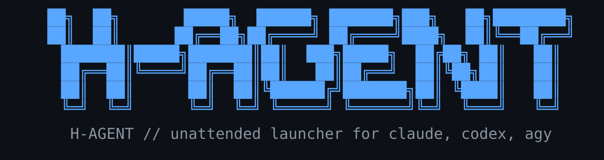

<div align="center">



<br/>

[](https://github.com/h-network/h-agent/actions/workflows/ci.yml)
[](LICENSE)


</div>

# h-agent

`h-agent` launches Claude Code, Codex, or agy with consistent unattended-mode
flags. It captures each agent's commands to a local log, forks sessions, tunes
reasoning effort, and can point Claude Code at a local inference endpoint.

The wrapper is standalone: it does not create a user, change identity, or
assume a particular username or home path. The selected CLI runs as the caller
and inherits that caller's `HOME` and configuration files.

> **New here?** The [**Quickstart**](https://github.com/h-network/h-agent/wiki)
> walks through install → first run → reading the command log.

## Install

Install for the current user with one command:

```sh
curl -fsSL https://raw.githubusercontent.com/h-network/h-agent/main/install.sh | bash
```

This installs `h-agent` plus Claude Code `2.1.302`, Codex CLI `0.163.0`, and the
latest agy available from its official installer. Claude Code and Codex CLI are
left untouched when the exact versions are already installed. Installation does
not require `sudo`.

Each CLI is installed independently: if one fails to download or install (a
dead installer URL, a bad release, etc.), the installer prints which one
failed and why, then continues with the rest — the other CLIs, `h-agent`
itself, `seedProfile`/`setupConfigDir`, and config seeding all still run. The
script only exits nonzero, with a final ok/failed summary, after everything
else has been attempted.

The installer also seeds unattended defaults in the invoking identity's
`$HOME`: Claude's completed-onboarding state and settings (including a status
line and a 500k-token auto-compact window for the default Sonnet/Opus models),
Codex's update/approval/sandbox defaults, and agy's command-capture hooks
(`~/.gemini/config/hooks.json`). Missing values are added, but existing user
values are never replaced. Project trust is granted only to the directory from
which the installer is run. The installer does not create or switch users and
works the same for root or any provisioned user/UID.

Choose a different h-agent prefix or stage a package by setting the same
variables supported by the Makefile:

```sh
curl -fsSL https://raw.githubusercontent.com/h-network/h-agent/main/install.sh | \
  PREFIX=/opt/h-agent DESTDIR=/tmp/package-root bash
```

Set `H_AGENT_VERSION` to install another Git ref, `H_AGENT_REPOSITORY` to use a
fork, or `H_AGENT_INSTALL_URL` to download `h-agent` itself from a custom URL.
`seedProfile`, `setupConfigDir`, their shared library, and `h-agent-capture`
download as siblings of that URL by default (same directory, their own
filenames); override them individually with `H_AGENT_SEEDPROFILE_URL`,
`H_AGENT_SETUPCONFIGDIR_URL`, `H_AGENT_PROFILELIB_URL`, and
`H_AGENT_CAPTURE_URL` if they live elsewhere.
Set `H_AGENT_INSTALL_CLIS=0` to install only the h-agent scripts, without any
CLI. When `DESTDIR` is set, the installer stages only those scripts and never
changes the invoking user's CLI installations or configuration. Set
`H_AGENT_SEED_CONFIG=0` to leave CLI configuration untouched. Merging defaults
into an existing Claude JSON file uses `jq` when present, otherwise `perl`
(its `JSON::PP` is a core module, and `perl` ships by default on Ubuntu,
Debian, and macOS where `jq` does not) — so a full merge needs no extra
package on a typical base image. If neither is available, only the
first-run-critical flags (`hasCompletedOnboarding`, `skipDangerousModePermissionPrompt`)
are injected and other defaults are skipped; existing values are never
replaced in any case.

System-wide (typically requires elevated permissions):

```sh
make install
```

For one user, choose a prefix inside that user's home directory:

```sh
make install PREFIX="$HOME/.local"
export PATH="$HOME/.local/bin:$PATH"
```

Packagers can set `DESTDIR`, `PREFIX`, or `bindir` independently. To stage a
package, for example:

```sh
make install DESTDIR=/tmp/package-root PREFIX=/usr
```

The target machine must provide Bash 4 or newer. A Makefile installation does
not install the agent CLIs; use the one-line installer above or provide a
supported CLI on `PATH`.

## Use

```sh
h-agent                 # AGENT_CLI, or claude by default
h-agent claude --resume
h-agent agy
h-agent codex
h-agent fork                    # fork your most recent claude session
h-agent fork <session-id>       # fork a specific session (original untouched)
h-agent fork codex [<id>]       # same for codex (fork subcommand; unverified)
h-agent probeProvider http://localhost:8000
h-agent probeProvider http://localhost:8000 my-model
h-agent --log                   # print the capture log
h-agent --log claude            # only claude's entries
h-agent --help
```

Approval prompts are skipped by default. This is intended for externally
sandboxed environments. Set `AGENT_SKIP_PERMISSIONS=0` when that is not
appropriate.

All configuration is supplied at runtime, so the same installation works for
any account and home directory:

- `AGENT_CLI`: default CLI (`claude`)
- `AGENT_SKIP_PERMISSIONS`: `1` to add unattended-mode flags (default), `0` not to
- `AGENT_CLAUDE_TOOLS`: space-separated Claude tool list; empty means unrestricted
- `AGENT_EFFORT`: Claude reasoning effort (default `high`; empty uses the model default) — one of `low`, `medium`, `high`, `xhigh`, `max`
- `AGENT_PROVIDER_URL`: local endpoint URL (Claude only)
- `AGENT_PROVIDER_MODEL`: model exposed by the endpoint
- `AGENT_PROVIDER_SMALL_MODEL`: optional smaller model
- `AGENT_PROVIDER_TOKEN`: optional endpoint token
- `AGENT_CAPTURE`: `1` logs agent hook events (default), `0` disables (claude, codex, agy)
- `AGENT_CAPTURE_FILE`: capture log path (default `~/.local/state/h-agent/commands.jsonl`)
- `AGENT_NAME`: instance label recorded as `name` in each log entry (e.g. a framework's per-agent name)

### Command capture

For Claude, Codex, and agy, `h-agent` records what the agent does to a local
JSON Lines log, one record per hook event. It logs session boundaries and shell
commands only — `SessionStart`, session end (`SessionEnd`, or `Stop` on agy),
and the before-tool event scoped to the shell command (`Bash` on claude/codex,
`run_command` on agy). It is **on by default**; set `AGENT_CAPTURE=0` to turn it
off.

How the hooks are wired differs per CLI, and none of it clobbers your own
config:
- **Claude** — inline per launch via `--settings` (merged with your settings).
- **Codex** — inline per launch via a `-c` TOML override plus
  `--dangerously-bypass-hook-trust` (Codex requires hooks to be trusted, and
  that can't be set through `-c` — consistent with h-agent already running Codex
  in bypass mode).
- **agy** — a global `~/.gemini/config/hooks.json` seeded at install (merged
  into any existing file). Because it's global, it captures **every** agy run on
  the machine, not only those launched through h-agent.

One capture script serves all three; it normalizes each CLI's payload (agy uses
a different, camelCase schema) into the same record: **commands and metadata
only** — event, tool name, the command, the tool-use/session ids, and the cwd.
Prompts and tool output are never logged. The log is created mode `600` at
`AGENT_CAPTURE_FILE`. agy hooks are synchronous and require a control response,
which the capture always emits first, so capture can never block or deny an agy
tool call.

Capture never interferes with the agent: the hook always exits successfully,
tolerates malformed input and an unwritable log, and needs no `jq`. It parses
payloads with `perl` (core `JSON::PP`); without `perl` it still records a
minimal, payload-free line per event. Note that logged commands can contain
secrets — the log is local and private, but it is plaintext.

To distinguish agents a framework spins up, set `AGENT_NAME` when launching:
each log entry then carries a `name` field, and the `[agent]` tag becomes
`[agent:name]`.

```sh
AGENT_NAME=researcher h-agent claude
```

Read the log back with `h-agent --log`, which prints one line per event
(timestamp, agent/name, short `#session`, event, tool, command). Pass a filter
to narrow to one CLI, one `AGENT_NAME`, or a session id (whole or a leading
prefix like the short `#id`), e.g. `h-agent --log claude`,
`h-agent --log researcher`, or `h-agent --log abcd1234`. It reads
`AGENT_CAPTURE_FILE`, formats with `perl` when available, and otherwise prints
the raw JSON Lines.

Codex hook dispatch has been reported to be unreliable in some front-ends, so
confirm commands actually appear in the log for your Codex version.

### Probe a local provider

`h-agent probeProvider <url> [model-id]` checks that a local endpoint is
actually usable by Claude Code. It discovers models from the OpenAI-compatible
`/v1/models` route, falling back to Ollama's `/api/tags`, and then sends a real
Anthropic-protocol request to `/v1/messages`. Passing a model ID verifies that
the endpoint lists that exact model before probing it; otherwise the first
discovered model is used.

The probe distinguishes a cold-load timeout, a missing Anthropic route, and an
HTTP response that is not an Anthropic message. On success it prints shell
exports for `AGENT_PROVIDER_URL` and `AGENT_PROVIDER_MODEL` (and
`AGENT_PROVIDER_TOKEN` when supplied). The command exits 0 when verified, 1
when unusable, and 2 for invalid usage.

The diagnostic requires `curl` and `jq`. Model listing uses a 10-second
timeout. Set `PROBE_TIMEOUT` to change the message-probe timeout from its
90-second default, and set `AGENT_PROVIDER_TOKEN` when the endpoint requires an
API key:

```sh
PROBE_TIMEOUT=180 AGENT_PROVIDER_TOKEN=local-secret \
  h-agent probeProvider http://localhost:8000/v1
```

### Named profiles

By default every CLI shares one profile at `$HOME/.claude` / `$HOME/.codex`.
Two commands, installed alongside `h-agent`, create isolated, named copies of
that default profile — for running multiple concurrent agents on one host
without them sharing config, skills, or (unless asked) logins. Neither ever
overwrites a file that already exists in the target profile, so re-running
either is always safe.

`setupConfigDir` is interactive: it prints `export`/`unset` lines for you to
`eval`, so it can switch your current shell.

```sh
eval "$(setupConfigDir work)"     # ~/.claude-work + ~/.codex-work, no login
eval "$(setupConfigDir work --same)"  # ...and copy today's logins across
eval "$(setupConfigDir default)"  # back to the shared ~/.claude + ~/.codex
setupConfigDir                    # show what this shell is currently on
```

`seedProfile` is noninteractive, for subprocesses and automation — one CLI
per call, printing the resulting variable rather than exporting it itself.
Login credentials are never copied; a seeded profile is unauthenticated by
design.

```sh
seedProfile claude ci-run           # CLAUDE_CONFIG_DIR=/home/you/.claude-ci-run
seedProfile --export codex ci-run   # export CODEX_HOME=/home/you/.codex-ci-run
```

Both validate the profile name (no path traversal, alphanumeric/`.`/`_`/`-`
only) and refuse `agy`: it has no config-dir override of its own (it reads
`~/.gemini/antigravity-cli` straight off `HOME`), so isolating it would mean
splitting `HOME` entirely rather than pointing an env var elsewhere.

## Develop

```sh
make test
shellcheck h-app/h-agent h-app/h-agent-capture install.sh h-app/seedProfile \
    h-app/setupConfigDir h-app/h-agent-profile-lib.sh h-app/test/h-agent-test \
    h-app/test/h-agent-capture-test h-app/test/install-test \
    h-app/test/profile-test h-app/test/probe-provider-test
```

## License

[PolyForm Noncommercial 1.0.0](LICENSE). Third-party agent CLIs remain under
their vendors' separate terms; see [NOTICE](NOTICE). Project and h-network
names are covered by the [trademark policy](TRADEMARKS.md).
